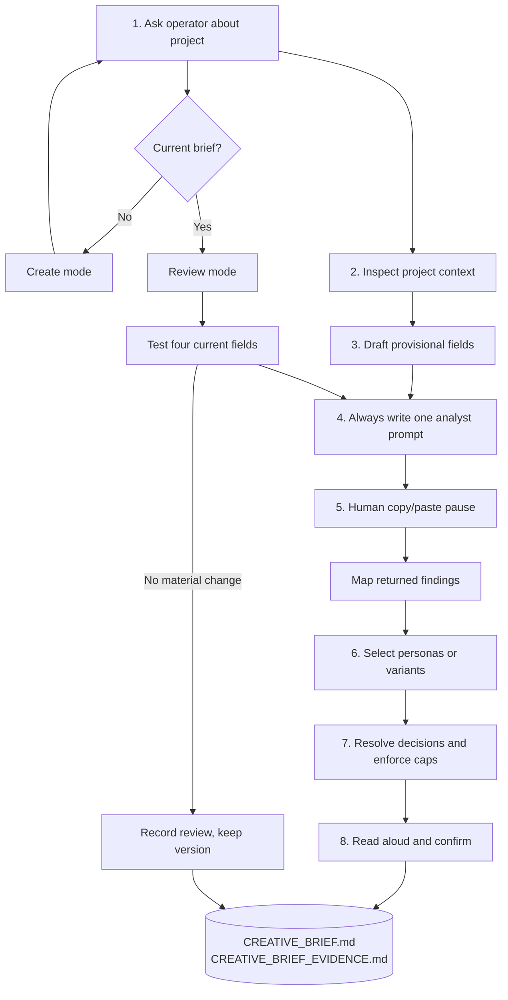
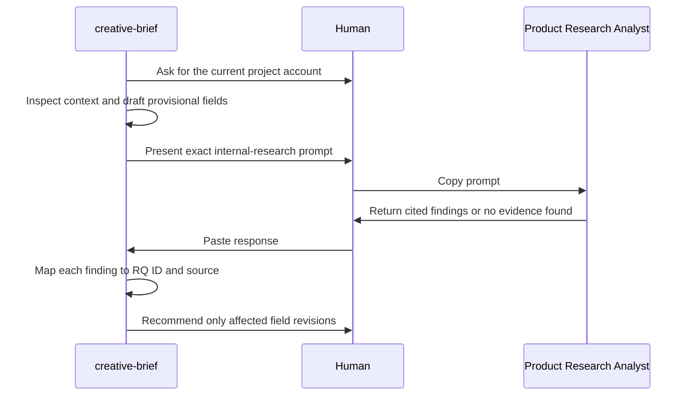

# Blueprint - how `creative-brief` works

The mechanics for someone deciding whether to use the skill or change it. The shorter explanation is
in [`README.md`](README.md).

## Two modes

## Create mode

| Step | Input | Question | Output | Done when | Reference |
| --- | --- | --- | --- | --- | --- |
| 1. Ask operator | Operator's account | What is happening, why does the business care, who is affected, and what needs clarification? | Classified project account | Everything the operator can answer or leaves uncertain is recorded | - |
| 2. Inspect context | Project files and available research | What does the accessible record support or challenge? | Source register, candidates, boundaries | Every relevant source was read; claims have a source or evidence state | - |
| 3. Draft provisional fields | Operator account and context | What should the research retrieval test? | Complete provisional brief | All four fields exist and every item maps to the companion | Templates |
| 4. Retrieve previous research | Provisional brief and gaps | What does prior internal evidence say about the problem, personas, needs, and trade-offs? | One consolidated prompt | The project-specific prompt covers all four fields and requires provenance | `research-roundtrip.md` |
| 5. Pause and resume | Analyst response pasted by the operator | What does traceable internal evidence support or challenge? | Mapped findings and candidate revisions | Every finding has a question ID, source, locator, and effect | `research-roundtrip.md` |
| 6. Select personas | Existing personas and research segments | Do existing personas fit, or is a proposed variant necessary? | Selected personas or documented variants | Every variant names its parent, shortcoming, evidence, assumptions, and validation need | - |
| 7. Resolve and cap | Revised candidate sets | Which objective, personas, needs, and principles belong now? | Four capped fields | All field tests and hard caps pass | Templates |
| 8. Confirm and save | Short brief and strongest limitation | Does this capture the problem, people, needs, and principles? | Matching current files | The operator confirmed it or both files are clearly marked draft | Templates |

## The four-field contract

| Field | Minimum | Maximum | Selection test |
| --- | --- | --- | --- |
| Project Objective | One objective, two sentences | One objective, three sentences | Centers the business problem, intended outcome, and why now |
| Key Personas | One persona | Two personas | A different choice would change a design decision |
| Key Scenarios | One user need | Three user needs | Names the person, goal, context, and consequence |
| Key Principles | One principle | Two principles | Resolves a trade-off likely in this design round |

These are hard caps. More content goes to the evidence companion. Combining several personas or
scenarios into one item to pass the count still fails.

## The two-file contract

### `CREATIVE_BRIEF.md`

The meeting instrument:

- status, version, review date, and companion link;
- Project Objective;
- Key Personas;
- Key Scenarios; and
- Key Principles.

No evidence tables, constraints section, requirements, risks, research findings, or next steps.

### `CREATIVE_BRIEF_EVIDENCE.md`

The extended agent context:

- orientation and the operator's account of the project;
- context inspected and source register;
- objective context;
- persona fit, proposed variants, user-need candidates, and principle candidates;
- enterprise boundaries;
- assumptions and unknowns;
- exact Product Research Analyst prompt;
- returned findings mapped to questions;
- confirmation; and
- change history.

Both files share a status, version, and review date. The short file is the current selection; the
companion explains and preserves the selection.

## Evidence states

Candidate personas and scenarios use four states:

| State | Meaning | Effect |
| --- | --- | --- |
| `supported` | Traceable internal evidence directly supports it | May be selected |
| `assumption` | A plausible answer has a stated basis but insufficient proof | May be selected only with the limitation visible in the companion |
| `unknown` | The available record cannot answer it | Preserve as an explicit unresolved gap after the analyst round-trip |
| `contradicted` | Current evidence materially conflicts with it | Do not select without an explicit operator decision and recorded reason |

Principles are different. They are usually commitments or preferences rather than facts. The
companion records the owner, basis, and trade-off instead of pretending research proves a value
choice.

## Product Research Analyst handoff

The skill writes one prompt during every create and review pass. It does not invoke the analyst.

The prompt always covers the business problem and outcome, existing persona fit and shortcomings,
observed user needs, recurring trade-offs, and research limitations. Project-specific questions name
the current assumption, affected field, and required evidence.

The analyst searches internal previous research only. It does not choose final content, create persona
variants, or recommend a solution.

## Review mode

| Result | Version | Record |
| --- | --- | --- |
| No material change | Preserve current version | Update review date and append `no material change` |
| Supporting evidence added, wording unchanged | Preserve current version | Add source and resolve assumption |
| Objective, selected persona, scenario, or principle changes | Increment after confirmation | Preserve prior value, trigger, source, and confirmer |
| Current evidence challenges a field, revision unresolved | Preserve current version; status `review-needed` | Record contradiction and pending decision |

There is one current short brief. The evidence companion carries lineage instead of a folder of dated
copies.

## Status

| Status | Meaning | Next move |
| --- | --- | --- |
| `draft` | The four fields exist but are not confirmed | Resolve open decisions or circulate as an explicit draft |
| `awaiting-research` | The consolidated internal-research prompt is waiting | Human runs the prompt and pastes the answer back |
| `review-needed` | New evidence or project change challenges a confirmed field | Reopen only affected fields |
| `ready` | The current four fields are confirmed and within every cap | Read and reconfirm before design discussion |

## Where it stops

The skill retrieves previous internal evidence through a human-run prompt; it does not plan or conduct
a study. Requirements, acceptance criteria, solution selection, implementation, delivery planning,
and authorization stay out of both creative-brief files.

## Cost

A create pass is one focused interview plus a mandatory analyst round-trip. Review repeats the
retrieval so the brief is tested against current previous research. The short brief remains cheap to
read because the evidence work stays in its companion.
