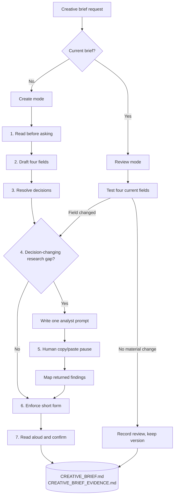
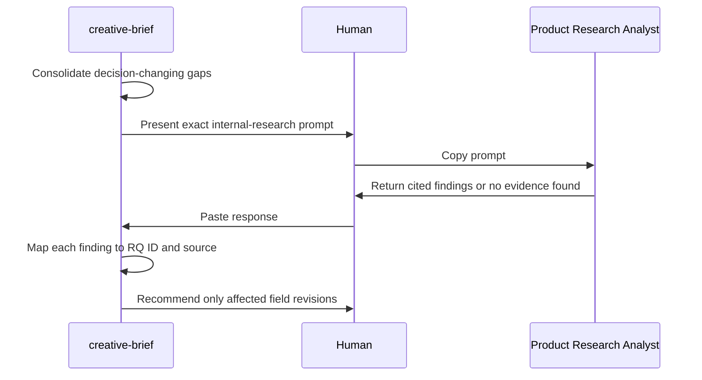

# Blueprint - how `creative-brief` works

The mechanics for someone deciding whether to use the skill or change it. The shorter explanation is
in [`README.md`](README.md).

## Two modes

## Create mode

| Step | Input | Question | Output | Done when | Reference |
| --- | --- | --- | --- | --- | --- |
| 1. Read before asking | Project files, internal research, prior decisions | What is already known or decided? | Source register, candidate fields, enterprise boundaries | Every accessible source that could change a field was read; claims have a source or evidence state | - |
| 2. Draft four fields | Current context | What should the team react to? | Complete provisional short brief | All four fields exist and every item maps to the companion | Templates |
| 3. Grill decisions | Draft and candidate sets | Which objective, personas, scenarios, and principles belong now? | Selected fields, assumptions, unknowns | Every currently answerable decision is settled or attached to a named gap | - |
| 4. Gate research | Unsupported and contradictory candidates | Could prior internal research answer this, and would it change the brief? | Dispositions or one consolidated prompt | Every qualifying gap is in the prompt; all others have a disposition | `research-roundtrip.md` |
| 5. Pause and resume | Analyst response pasted by the user | What does traceable internal evidence support or challenge? | Mapped findings and field revisions | Every finding has a question ID, source, locator, and effect | `research-roundtrip.md` |
| 6. Enforce short form | Revised draft | Can this be read in about two minutes? | Four capped fields; overflow in companion | Every cap passes and there is no fifth section | Templates |
| 7. Confirm and save | Short brief and strongest limitation | Does this describe the current design work? | Matching current files | The user confirmed it or both files are clearly marked draft | Templates |

## The four-field contract

| Field | Minimum | Maximum | Selection test |
| --- | --- | --- | --- |
| Project Objective | One objective, two sentences | One objective, three sentences | Names the part of the project being designed now |
| Key Personas | One persona | Two personas | A different choice would change a design decision |
| Key Scenarios | One scenario | Three scenarios | Names a trigger, goal, and context |
| Key Principles | One principle | Two principles | Resolves a trade-off likely in this design round |

These are hard caps. More content goes to the evidence companion. Combining several personas or
scenarios into one item to pass the count still fails.

## The two-file contract

### `CREATIVE_BRIEF.md`

The meeting instrument:

- status, version, review date, and companion link;
- Project Objective;
- Key Personas;
- Key Scenarios; and
- Key Principles.

No evidence tables, constraints section, requirements, risks, research findings, or next steps.

### `CREATIVE_BRIEF_EVIDENCE.md`

The extended agent context:

- orientation for an agent joining the project;
- context inspected and source register;
- objective context;
- complete persona, scenario, and principle candidate sets;
- enterprise boundaries;
- assumptions and unknowns;
- exact Product Research Analyst prompt;
- returned findings mapped to questions;
- confirmation; and
- change history.

Both files share a status, version, and review date. The short file is the current selection; the
companion explains and preserves the selection.

## Evidence states

Candidate personas and scenarios use four states:

| State | Meaning | Effect |
| --- | --- | --- |
| `supported` | Traceable internal evidence directly supports it | May be selected |
| `assumption` | A plausible answer has a stated basis but insufficient proof | May be selected only with the limitation visible in the companion |
| `unknown` | The available record cannot answer it | Research gate or explicit unresolved gap |
| `contradicted` | Current evidence materially conflicts with it | Do not select without an explicit user decision and recorded reason |

Principles are different. They are usually commitments or preferences rather than facts. The
companion records the owner, basis, and trade-off instead of pretending research proves a value
choice.

## Product Research Analyst handoff

The skill writes one prompt after the initial pass. It does not invoke the analyst.

Each question names:

- the current assumption;
- the brief decision affected;
- the finding that would change the brief; and
- the evidence and locator required.

The analyst searches internal previous research only. It does not choose the final brief content and
does not recommend a solution.

## Review mode

| Result | Version | Record |
| --- | --- | --- |
| No material change | Preserve current version | Update review date and append `no material change` |
| Supporting evidence added, wording unchanged | Preserve current version | Add source and resolve assumption |
| Objective, selected persona, scenario, or principle changes | Increment after confirmation | Preserve prior value, trigger, source, and confirmer |
| Current evidence challenges a field, revision unresolved | Preserve current version; status `review-needed` | Record contradiction and pending decision |

There is one current short brief. The evidence companion carries lineage instead of a folder of dated
copies.

## Status

| Status | Meaning | Next move |
| --- | --- | --- |
| `draft` | The four fields exist but are not confirmed | Resolve open decisions or circulate as an explicit draft |
| `awaiting-research` | The consolidated internal-research prompt is waiting | Human runs the prompt and pastes the answer back |
| `review-needed` | New evidence or project change challenges a confirmed field | Reopen only affected fields |
| `ready` | The current four fields are confirmed and within every cap | Read and reconfirm before design discussion |

## Where it stops

| Neighbor | Boundary |
| --- | --- |
| `problem-framing` | Establishes which problem is worth solving and writes `FRAMED_PROBLEM.md`. `creative-brief` may start from a selected design objective and does not feed the main chain |
| Research | The skill retrieves previous internal evidence through a human-run prompt. It does not plan or conduct a study |
| `shaping` | Compares solution directions against a frame. This skill selects no mechanism beyond what the existing Project Objective already names |
| `proposal` | Writes the document a decision-maker approves or declines. A creative brief aligns a design meeting |
| PRD or specification | Requirements, acceptance criteria, states, implementation, and delivery planning stay out of both creative-brief files |

## Cost

A create pass is one focused interview plus an optional analyst round-trip. The short brief is cheap to
review because the evidence work stays in its companion. If the team needs causal comparison,
solution-open framing, or a downstream delivery contract, the smaller artifact is the wrong one and
`problem-framing` should run instead.

