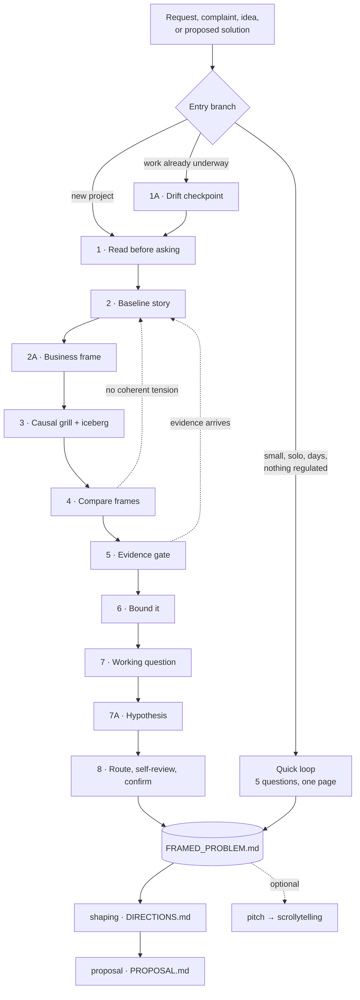
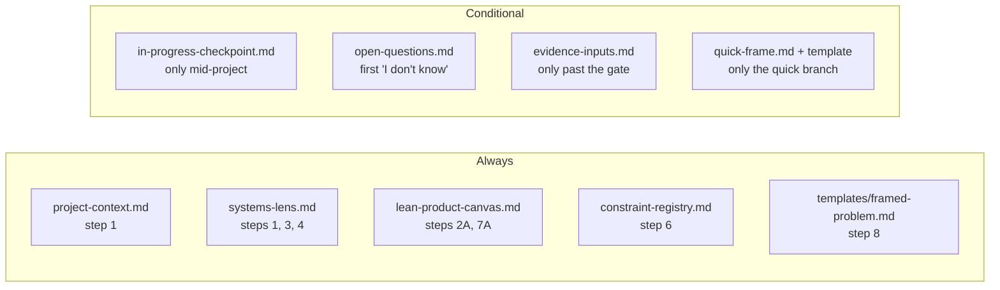

# Blueprint — how `problem-framing` works

The mechanics, for someone deciding whether to use the skill, extend it, or work out why a pass went the way it did. The short version of what the skill is *for* is in [`README.md`](README.md); this is the wiring.

## One pass, end to end

## The steps

| Step | Input | The question it answers | Output | Done when | Reference |
| --- | --- | --- | --- | --- | --- |
| 1 · Read before asking | Every document, note, and repository source in scope | What is already on record? | Ledger of Observations, Interpretations, Assumptions, Commitments, Preferences; source register with IDs and locators; actor map | Every material claim is classified and carries a source ID; the context library is located or its absence recorded | `project-context.md`, `systems-lens.md` |
| 1A · Drift checkpoint | Original brief, decisions, work produced, evidence since kickoff | What changed since this started? | Named drift, prior decisions marked preserve / revisit / superseded | Every material difference has a cause, evidence, and consequence | `in-progress-checkpoint.md` |
| 2 · Baseline story | The ledger | What actually happened to one person? | `[User] tried to [goal] in [context], but [limitation], so [workaround], causing [consequence]` | A reader can picture where the current way breaks; all four baseline questions answered or marked as gaps | — |
| 2A · Business frame | Source material | Why does the organisation care, and what will it count? | Business problem statement + a behaviour-change business outcome | Both traceable to source IDs, or explicitly missing with the consequence | `lean-product-canvas.md` |
| 3 · Causal grill | Baseline story | Is this the cause or a symptom, and what keeps producing it? | Pressure-tested tension; iceberg down to the mental model | The tension is causal enough to guide exploration; the iceberg reaches structure or records its origin as unknown | `systems-lens.md`, `open-questions.md` |
| 4 · Compare frames | The tension | What else would explain the same behaviour? | Three to five candidate frames, a recommendation, the options landscape | A competing frame got a fair test; every set-aside option has a *why not now* | — |
| 5 · Evidence gate | Assumption ledger | Which uncertainty is worth spending time on? | Dispositions; targeted evidence requests; the single riskiest assumption and the least work to settle it | Every high-impact low-confidence assumption is supported, accepted as risk, or attached to a specific input | `evidence-inputs.md` |
| 6 · Bound it | Chosen frame | What is in, what is out, and what cannot move? | Slice, exclusions, constraint registry, time budget, risks | The slice is one coherent challenge; every constraint has an owner and an authority source | `constraint-registry.md` |
| 7 · Working question | The bounded frame | What question do solutions have to answer? | `How might we…`, solution-open | All five question tests pass | — |
| 7A · Hypothesis | Steps 2A, 6, 7 | What would prove the frame right? | `We believe [business outcome] if [user] achieves [user outcome]` | Measurable, names no mechanism, missing clauses marked open | `lean-product-canvas.md` |
| 8 · Route and confirm | Everything | Is this ready, and what did we agree to not know? | Routed open questions, self-review, `FRAMED_PROBLEM.md` | Every open question routed; the user confirmed the frame and the risks accepted | `open-questions.md`, `templates/framed-problem.md` |

## What gets read, and when

Reference files are not read up front. Each one loads at the point it is needed, which keeps a short pass short:

## The registers

Four tables carry state through a pass, and each exists to stop a specific failure.

| Register | Fields | The failure it prevents |
| --- | --- | --- |
| Source register | `ID · Date · Speaker · Type · Quote · Locator` | A claim nobody can trace back, six months later |
| Options landscape | `Option · What it addresses · Who benefits · Signal strength` | The first plausible idea becoming the problem by default |
| Constraint registry | `ID · Constraint · Owner · Authority source · Reversibility · Review` | A preference being enforced as though it were law |
| Open questions | `ID · Question · Decision · Who knows · Why unanswered · Consequence` | A risk taken because nobody wrote down that it was unknown |

## Statuses and what each one triggers

| Status | Means | Next move |
| --- | --- | --- |
| `ready-for-directions` | The frame holds and the user confirmed it | Hand to `shaping`. It buys exploration time, not a build |
| `revisit-directions` | Mid-project, and the frame changed | Back to `shaping`, naming which decisions survive |
| `continue-current-frame` | Mid-project, and new evidence supports the original frame | Continue, citing the evidence, watching the stated risks |
| `evidence-needed` | An open question clears all four gate tests | Run the exact query; return here with the result |
| `needs-reframing` | The user, cause, outcome, or boundary is not coherent | Back to step 2 or 4 |
| `split` | No single tension survives | One framing pass and one file per independent problem |
| `stop` | No meaningful problem, value, or ownership | Stop dependent solution, proposal, and design work |

## Where the skill stops

| Boundary | This skill | The other skill |
| --- | --- | --- |
| `shaping` | What problem, for whom, bounded by what | Which mechanism, compared how, inside the budget |
| `proposal` | The problem people can act on | The document people approve or decline |
| `context-intake` | Reads the context library | Builds and maintains it |
| `pitch` | The frame as it stands | How to explain a decision already made |

The hypothesis is the clearest seam: framing writes `We believe [business outcome] if [user] achieves [user outcome]` and stops. `shaping` appends `using [direction]`. If a framing pass ever fills that clause, `shaping` has already happened and the fit check is decoration.

## Cost

A full pass is roughly fifteen to twenty-five questions, asked one at a time, plus whatever reading the sources require. The quick branch is five. If a full pass is running past thirty questions without the frame settling, that is usually a `split`, not a longer interview.
