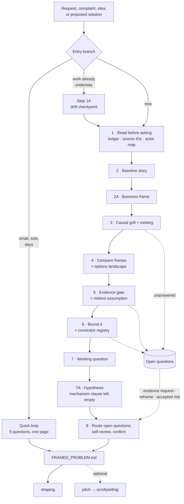

# Problem Framing

Work out what problem is actually being solved, before or during delivery, until the team can choose what to work on without smuggling in a solution. Treat the frame as a working model that evidence may reopen.

Use a **docs-first, one-question-at-a-time** interview. Three moves: **Why** exposes the real tension, **What if** challenges the frame, and **How** turns a critical uncertainty into evidence work. Stay on the problem side; exploring and packaging solutions belongs to later skills.

Act as the designer's question memory. Make sure the important questions — about the user, the observed episode, the cause, the evidence, the outcome, the alternatives, the boundary, the constraints, the time budget, and the risks — are answered or explicitly recorded before solutions are proposed. Do not dump the checklist on the designer; pick the highest-leverage unresolved question, ask it, update the frame, and continue.

**"I don't know" is a valid answer.** The designer will not be able to answer everything, and a question they cannot answer is information about the project, not a failure of the interview. Record it, ask at most one follow-up — *who would know?* — and move on. Never push, and never fill the gap with something plausible. Read `references/open-questions.md` the first time this happens: it holds the register, and the rule that every open question must route to an evidence request, a reframe, or an explicitly accepted risk before the frame can be marked ready.

Conduct the interview, the recommendations, and the written artifact **in English**, always — including when the user writes in Spanish, Spanglish, or a mix. Understand them in whatever language they use; answer in English. `FRAMED_PROBLEM.md` is read by `shaping`, by `proposal`, and by people who were not in the room, so it stays in one language regardless of who ran the interview. Say this once, in one line, the first time the user writes in another language, and then stop mentioning it.

## Preserve the boundary

Produce a `Framed Problem`. Stop before solution concepts, requirements, flows, breadboards, wireframes, acceptance criteria, implementation tasks, or a proposal. For work in progress, assess whether the current problem still justifies and bounds the work; leave delivery health, implementation quality, and task planning to their own reviews.

Define the **time budget** as the fixed amount of time the team is willing to spend building the solution. It is a constraint, not an estimate derived from a scope: the solution gets adapted to fit the time. Record it when the user or source material supplies one. If it is not yet defined, do not invent it; mark it open and state the project consequence — expanding solution work, delayed trade-offs, or a proposal nobody can evaluate as a bounded commitment.

What comes next: `shaping` takes `FRAMED_PROBLEM.md` and explores two or three materially different solution directions, checks each against the requirements the frame implies, and picks one with no unresolved unknowns. Then `proposal` turns the selected direction, the time budget, the rabbit holes, and the exclusions into the document people sign off on. After that, **Design** does the detailed interaction work inside that direction, using `FRAMED_PROBLEM.md` and the proposal as guardrails against drift. Do none of that here; prepare the evidence, boundaries, and open questions those steps have to respond to.

Framing does not earn a commitment to build. It earns a commitment to **spend time exploring solutions**: agreement that if this can be solved inside the stated time budget, the result would be worth having. Say so when handing off, so nobody reads a framed problem as an approved project.

## The shape of a pass

Steps 1–8 are the loop; 1A, 2A, and 7A are additions to it, and the dotted lines are where a pass leaks work sideways rather than forward. The full version — inputs, outputs, completion criteria, reference load order, and the boundary lines against `shaping` and `proposal` — is in [`docs/problem-framing/blueprint.md`](../../../docs/problem-framing/blueprint.md).

## Choose the entry branch

- **New project**: recover a baseline story from the raw initiative, then run the full framing loop.
- **In-progress project**: first reconstruct a frame checkpoint from the original brief, decisions, work produced, feedback, and evidence gathered since work began. Then run the same loop against the updated record.
- **Quick frame**: a small piece of work, usually solo, that still needs the problem stated correctly before anyone starts sketching. Run the short loop in `references/quick-frame.md` instead of the full one.

Use the in-progress branch whenever work has begun, including discovery, solution exploration, design, prototyping, or implementation. Preserve valid prior decisions, but treat effort already spent as cost history rather than evidence that the frame is correct.

### When quick is the honest answer

Take the quick branch when **all** of these hold:

- one person, or a pair, will do the work;
- the time budget is days, not weeks;
- one user and one moment — no competing populations to reconcile;
- nothing regulated, no permission model change, no system of record involved;
- being wrong is cheap and reversible.

Say which branch you are taking and why, in one line, before starting. The full loop on a two-day fix is its own failure mode: it costs more than the work and teaches people that framing is bureaucracy.

Read `references/quick-frame.md` before running it. It carries the short loop, the one-page output, and — the part that matters — the four conditions that end the quick pass and send the work back to the full loop.

## Run the framing loop

### 1. Read before asking

Inspect every relevant document, attachment, note, product surface, research artifact, and repository source available in scope.

Many projects keep their durable product and research context in a **project context library** — a repository or directory separate from the codebase. Read `references/project-context.md` before this step and follow it to find that library, read it for provenance, and record where it lives. Locating it is part of this step, not an optional extra: it is where most of the facts you would otherwise ask the designer for already are.

Extract:

- raw request and any embedded solution;
- users and stakeholders: requester, primary user, beneficiary, decision-maker, and cost-bearer — rendered as the **actor map** in `references/systems-lens.md`, because who experiences the problem, who decides, and who holds the information are three different columns and the mismatches between them change the boundary;
- observed episodes, current behavior, workarounds, and consequences;
- stated outcomes, constraints, commitments, and time budget;
- contradictions, missing provenance, and loaded terminology.

For an in-progress project also read `references/in-progress-checkpoint.md` and extract what it lists: the original frame, current stage and solution direction, decisions and their reversibility, work produced, evidence accumulated since kickoff, and the event that triggered this checkpoint.

Build a private ledger using these labels:

- **Observation**: directly seen or traceable to a source.
- **Interpretation**: an explanation of observations.
- **Assumption**: an unverified condition the frame depends on.
- **Commitment**: a decision already made by an authorized person.
- **Preference**: a value judgment or favored direction.

Keep the strongest observations as **quoted source material**: the speaker's own words, attributed to a person and a moment. Quotes are the frame's ground truth; every other line in the artifact is an interpretation of them. Paraphrase only when the original is unavailable, and say that you did.

Give every entry a **stable ID** — `S01`, `S02`, `S03` — and a **locator**: the timestamp in the recording, the line in the transcript, the path and heading in the document, the ticket URL. The ID is what lets every later section point at its evidence instead of restating it; the locator is what lets a reader six months from now verify the claim without re-reading the whole source. Record both in the source register described in `templates/framed-problem.md`, and cite them inline as `(→ S01, S03)` everywhere else in the artifact.

Apply the traceability test to every claim you are about to record: **who said this, and where?**

- Traceable to a person and a moment → keep it and cite it.
- Directly implied by what someone said → keep it, mark it implied, and state the reasoning.
- Neither → drop it. A claim nobody made does not become true by being plausible.

Completion criterion: every material claim in the input is classified and carries a source ID, the project context library has been located or its absence recorded, facts discoverable from available sources have been looked up instead of delegated to the user, each Observation carries a locator or an attributed quote, and an in-progress project has a traceable record of original frame, current work, intervening evidence, and existing commitments.

### 1A. Diagnose frame drift for work in progress

Skip this step for a new project.

Compare the original frame, current project, and evidence gathered since kickoff. Name every material difference using the drift taxonomy in `references/in-progress-checkpoint.md`, and classify prior decisions as `preserve`, `revisit`, or `superseded` with the evidence and consequence for each.

Completion criterion: every material difference between the original and current frame has a cause, evidence, and decision consequence.

### 2. Recover the baseline story

Replace the feature label or generalization with at least one concrete episode:

`[User] tried to [goal] in [context], but [current limitation], so [workaround or failure], causing [meaningful consequence].`

Lead with: “Tell me about the most recent time this happened. What was the person trying to do, where did they get stuck, what did they do next, and what was the consequence?” Ask only the first unresolved part, then follow the answer.

Ask for observable behavior when the answer uses abstractions such as “better experience,” “more intuitive,” “users need,” or “improve engagement.” Distinguish who asks for the work from who experiences the problem.

Before leaving this step, confirm four answers exist. They are what makes a frame something later ideas can be judged against:

1. What is the current way people do this, without any new solution?
2. When does the current way stop working?
3. What were they trying to accomplish at that moment?
4. How would anyone know the new way is working better?

Answer 4 is the outcome the rest of the frame is measured by. If it is missing, the frame cannot reject a bad solution later. Mark it as a critical gap rather than inventing a metric.

Completion criterion: a reader can picture where the current way breaks, all four questions are answered or explicitly marked as critical evidence gaps, or the missing episode is explicitly marked as a critical evidence gap.

### 2A. State the business frame

The baseline story says what breaks for one person. This step says why the organisation cares, and what it will count. Without it, a frame can be entirely true and still fail to earn the time budget — and the proposal downstream gets judged on plausibility instead of on a number.

Read `references/lean-product-canvas.md` before this step. Produce two things:

**The business problem statement.** What changed in the world, what that change did to the business, and a How Might We that opens the response. The change is observable from outside — a market shift, a competitor, a regulation, a change in what users do — never "we need a feature". Write it only from source material, citing the IDs. When nothing in the sources says what changed or what it cost, do not compose one: mark it missing and record the consequence, which is that nobody can tell whether this problem deserves the time budget.

**The business outcome.** A change in someone's behaviour, with a number. The test: *can this be true without anyone doing anything differently?* If yes, it is an output — "ship the bulk approval screen", "increase adoption" — and it goes back. If the team measures nothing that would show the behaviour changing, that is an open question, not a licence to write something vaguer.

Keep this separate from the user's own goal, which belongs to step 6. Business outcome is what the business will count; user outcome is what the person wanted. When they point in different directions, that is a finding — record it rather than smoothing it.

Completion criterion: the business problem statement names a change and its consequence with source IDs, or is explicitly marked missing with its consequence; and the business outcome describes a behaviour change rather than an output, or is recorded as an open question.

### 3. Grill the causal frame

Ask one high-leverage question at a time and wait for the answer. With each question:

1. State what uncertainty or decision the question tests.
2. Offer a recommended answer or working hypothesis based on current evidence.
3. Update the ledger after the response.
4. Follow the branch until it is resolved or converted into an evidence need.

When the answer is "I don't know", record the question in the open-questions register with the decision it informs and what not knowing costs, ask *who would know?*, and move to the next question. Do not rephrase and re-ask.

Pressure-test:

- symptom versus cause;
- frequency, severity, and consequence;
- affected user versus vocal requester;
- current workaround and why it is insufficient;
- business outcome versus user outcome;
- alternative explanations for the same behavior;
- the consequence of leaving the situation unchanged;
- solution language hidden inside the problem statement.

When a proposed solution dominates the discussion, set that mechanism aside and ask what outcome still matters. Challenge the idea, not the person.

Then go one level below the cause. Read `references/systems-lens.md` and run the **iceberg**: event, pattern, structure, and the belief that made the structure look reasonable. Two questions, asked once the pattern is established — *what structure or policy produces this?* and *what did someone believe, when that was set up, that made it look reasonable?* The belief goes into major risks, because it predicts which solutions get blocked. Leave the level empty rather than inventing a belief nobody expressed.

Two more tools in that file are conditional. Run the **object map** only when the problem concerns a system of record, data shared across roles, or a relationship between domain entities — it classifies the request as a new object, attribute, relationship, or action, and those have very different scopes. Run the **causal loop** only when the baseline story contains a fix that was tried and did not hold. Skip both otherwise and say nothing about it.

Completion criterion: the central tension is causal enough to guide exploration, the iceberg reaches structure and either names the belief underneath it or records that its origin is unknown, each unresolved causal claim appears in the assumption ledger, and every question the designer could not answer appears in the open-questions register with the decision it informs.

### 4. Compare plausible problem frames

Generate three to five materially different candidate frames. Vary at least two of: user, moment, causal explanation, desired outcome, or boundary. Include:

- the strongest version of the original frame;
- a credible competing explanation;
- a narrower frame that could stand alone;
- a frame that removes the proposed solution.

Explain the purpose in plain language: the same behavior can have different causes, users, or useful boundaries. Comparing those explanations prevents the first plausible story from becoming the problem by default.

Present the candidates to the designer and ask: “Which explanation best matches what we have observed, and what evidence would make us choose another?” Recommend one before asking.

Compare candidates on:

- **Decision relevance**: choosing it would change what the team explores.
- **Evidence fit**: observations support it without overstating certainty.
- **Leverage**: it addresses a meaningful cause or bottleneck.
- **Ownership**: the team can influence the outcome.
- **Openness**: multiple solution mechanisms remain possible.
- **Boundability**: a coherent fraction can be explored separately.
- **Business urgency**: it matches something the business cares about *right now* — churn, a launch, a renewal risk, an audit finding, a commitment already made externally. A real user problem that matches no current imperative is real and still not this cycle's work.
- **Durability**: whether it changes the arrangement producing the pattern, or adjusts something on top of it. Judge this using the leverage-point ordering in `references/systems-lens.md` — silently. Never show the user the list, never ask them to place a frame on it, and never use the phrase in the artifact. Write the implication in the frame's own words instead: *"Frame A changes who can see what is waiting on them, so the pattern stops recurring; Frame B adds a reminder, which works while someone maintains it."*

Recommend one frame and explain the decisive trade-off. Keep rejected frames with the evidence that would revive them.

#### Record the options landscape

Everything that surfaced during framing — every problem, request, and idea, not just the frames you formalized — goes into one table so the choice is visible instead of implied:

| Option | What it addresses | Who benefits | Signal strength |
| --- | --- | --- | --- |

Signal strength is evidence volume and quality, not enthusiasm: how many distinct sources raised it, how recently, and how directly they were affected. One loud mention is not traction.

Then write the case for the one chosen: **why this one now**. Argue *why not now* for the others — never *why not ever*. A rejected option with a "not ever" verdict stops being reconsidered when the evidence changes, which is the failure this table exists to prevent.

#### Use the flip when options will not rank

When the discussion stalls on which idea is best, stop comparing ideas and ask two questions about each:

1. What are they doing instead today?
2. What is bad about that?

Ranking ideas invites preference. Ranking the cost of the current workaround exposes urgency, and urgency is what lets the team say no to most options and yes to one.

Completion criterion: at least one plausible competing frame has received a fair test, the options landscape lists what was set aside with a *why not now*, and the recommendation follows from stated evidence and trade-offs.

### 5. Pass the evidence gate

Rank assumptions using four questions:

1. Would falsity materially change or stop the project?
2. Is current evidence weak, indirect, stale, or contradictory?
3. Can additional evidence realistically reduce the uncertainty?
4. Would the result change the selected frame or its boundary?

Trigger focused evidence work only when all four answers are yes. First use sources already in scope. Then use the designer's research library and metrics tool when available; ask for a targeted input or run the tool directly instead of requesting "more research" in general.

Read `references/evidence-inputs.md` and use its formats: what a metrics input must specify, what a research-library input must specify, and the focused evidence request to fall back on when neither source can answer the uncertainty. Ask one evidence-input question at a time and recommend the exact query or filter.

After new evidence arrives, return to the baseline story and candidate frames. General research that cannot change a decision does not block framing.

Run the same four questions over the open-questions register. A question that clears all four becomes an evidence request; one that does not is heading for accepted risk, and the routing happens at step 8.

Completion criterion: every high-impact, low-confidence assumption is either supported, explicitly accepted as risk, attached to a targeted metrics or research-library input, or attached to another decision-changing evidence request; and the single riskiest open assumption *right now* is named, with the smallest piece of work that would settle it.

### 6. Bound the chosen problem

Define:

- primary user: the person who directly experiences the problem;
- context: the moment and conditions in which the problem occurs;
- desired outcome: the observable behavior or decision that should improve;
- user outcome and benefit: what the person themselves wants out of it, in their own terms — the goal, the benefit, and the relief. Kept separate from the business outcome in step 2A on purpose: one is what the business counts, the other is what the person wanted, and collapsing them produces solutions that move the metric without helping anyone;
- problem slice included now: the meaningful part the team will address, which may be smaller than the whole problem;
- adjacent problems and users outside this frame;
- constraints and commitments: fixed limits or prior decisions that the work must respect, recorded as a **constraint registry** rather than prose. Read `references/constraint-registry.md` before writing it: it holds the fields, the six authority sources and what each implies about reversibility, and the question that reclassifies a stated constraint into a preference;
- time budget, if supplied: the fixed build time the team chooses to invest; constrain time and adapt the solution rather than estimating time from a fixed scope;
- major risks: uncertainties, dependencies, policy, data, or organizational issues likely to destabilize future solution exploration;
- explicit exclusions: directions intentionally excluded from this framing pass.

Some constraints and exclusions are optional at this stage. Never fabricate them merely to complete the template. For every optional field left undefined, record:

1. what is unknown or undecided;
2. why it may be acceptable to defer;
3. what could concretely happen while exploring directions, writing the proposal, or designing, if it remains undefined;
4. the latest decision point by which it must be resolved.

Write consequences as project behavior, not generic risk labels. Prefer “without a supported-payroll boundary, solution exploration may spread across every payroll configuration and exceed the two-week build budget” over “scope risk.”

Use a compact example when explaining the boundary. For the onboarding case:

- **User**: a trial admin whose setup requires Finance approval.
- **Context**: before account setup, when required approvals and information must already be available.
- **Desired outcome**: the admin arrives prepared and can complete setup without contacting support.
- **Constraint**: Finance owns the approval and the product cannot bypass it — `C`, owner CFO, regulatory, not reversible by this team.
- **Time budget**: two weeks of build time, only if the team has explicitly chosen that investment; the solution gets reduced or changed to fit it.
- **Major risk**: the product may not be able to identify Finance-dependent accounts early enough.
- **Chosen slice**: help these admins prepare before setup—not redesign onboarding for every user or solve the entire approval process.

For an in-progress project, also state which current work remains aligned, which solution decisions need to be revisited, and which work falls outside the revised frame. Describe impact without producing an implementation plan.

Split grab bags whose parts do not share one user, baseline story, and outcome. Preserve constraints as constraints; keep proposed mechanisms in the source record rather than in the chosen frame.

#### Add a Less about / More about guardrail when the wrong direction is obvious

Exclusions say what is outside the boundary. This says what *kind* of solution the evidence does and does not point to, in the reader's own terms:

- **Less about**: the direction someone could reasonably head toward after reading the problem correctly, and which the evidence does not support.
- **More about**: the direction the evidence does support, stated at the same level.

Write it only when there is a common misunderstanding or an obvious-but-wrong direction — for example, *less about adding another notification, more about the admin knowing what is already waiting on them*. Keep both sides symmetric and short. Do not use it to smuggle in a preferred mechanism: it constrains the kind of answer, never names the answer. Omit the section when no such misunderstanding exists.

Completion criterion: the included slice forms one coherent solution-exploration challenge, every constraint carries an owner and an authority source or has been reclassified as a preference, and exclusions prevent adjacent work from silently entering it.

### 7. Form the working question

Write a question that preserves the tension and invites multiple mechanisms. Prefer:

`How might we help [user] achieve [observable outcome] when [context/tension], while respecting [material constraint]?`

Use the template only when it clarifies the frame. Test the question:

- Does it change an important design decision?
- Does it describe an outcome rather than an artifact?
- Can multiple legitimate approaches answer it?
- Can evidence or a future solution test it?
- Can the team act on it inside the chosen boundary?

Completion criterion: all five answers are yes, or the artifact remains `needs-reframing` with the failed checks named.

### 7A. Write the hypothesis

The working question is deliberately open, which means it has no stopping condition — nothing about it can turn out to be false. The hypothesis adds one, without naming a mechanism:

`We believe [business outcome from step 2A] will be achieved if [user] achieves [user outcome from step 6].`

The mechanism clause is deliberately empty. `shaping` appends `using [selected direction]` once a direction exists, and the completed sentence is what the proposal is judged against later. Say in the artifact that the clause is empty on purpose, or the first reader will assume something was forgotten.

Two ways this goes wrong. A hypothesis that names a mechanism has skipped the whole of `shaping` and made the fit check decorative. A hypothesis whose business outcome is an output — *"we believe the bulk approval screen will be shipped if…"* — is not falsifiable, because shipping is under the team's control.

Where step 2A left the business outcome as an open question, write the hypothesis with that clause marked open and carry it forward. A hypothesis with a hole in it is more useful than a hypothesis with a number nobody measured.

Completion criterion: the hypothesis states a measurable business outcome and a user outcome, names no mechanism, and either cites the source IDs behind both or marks the missing clause open.

### 8. Confirm and emit the handoff

Route every open question first. Each one resolves as an **evidence request** (it clears the four gate questions), a **reframe trigger** (the frame cannot be bounded without it), or an **accepted risk** (the frame holds without it). An accepted risk moves into the frame's major risks carrying its `Q` ID, its consequence, who accepted it, and when. `references/open-questions.md` holds the routing rule; a question with no routing decision blocks readiness.

Then run the self-review, before presenting anything. Six checks, against the draft as it stands:

1. Any claim in the frame with no source ID behind it?
2. Any constraint with no owner or no authority source — or any preference sitting in a `C` row?
3. Any assumption whose falsity would kill the project, with a blank disposition?
4. Any open question with no routing decision?
5. Does the working question name a mechanism, or the hypothesis fill the `using` clause?
6. Is the business outcome something that could be true with nobody behaving differently?

Fix what you can and name what you cannot. Running this before presenting rather than after is the point: a frame that arrives with its own gaps already marked gets corrected once, and a frame that arrives clean and turns out not to be gets read more sceptically from then on.

Present the recommended frame and its strongest unresolved challenge. Ask the user to confirm the frame before marking it ready. Present the accepted risks as part of what they are confirming — accepting a risk is a decision the user makes, not one the skill makes for them. If the user requested an asynchronous pass, emit a draft and mark assumptions, accepted risks, and confirmation as pending.

Write the confirmed artifact to `FRAMED_PROBLEM.md` inside the project, using the exact structure in `templates/framed-problem.md`. Read that file before writing: it also states where to save the artifact and why the frame becomes the project's problem north star.

Then offer one thing, in one line, and take no for an answer: if the frame has to be explained to people who were not in the interview, `pitch` can turn it into a narrative and `scrollytelling` into an article. Read `references/frame-beats.md` before offering — it holds the draft beat set to hand `pitch` so it starts from the frame rather than a blank page. Only after confirmation, never from a draft, and say plainly that the article is a communication artifact while `FRAMED_PROBLEM.md` stays the north star.

## Readiness rule

Mark `ready-for-directions` for a new project, or `revisit-directions` for an in-progress project whose frame changed, only when all are true:

- a concrete baseline story exists;
- the chosen frame names a user, tension, consequence, and desired outcome;
- the business problem statement and business outcome are present, or explicitly marked missing with their consequence;
- evidence and interpretation are distinguishable and traceable, and every material claim carries a source ID;
- critical assumptions have a disposition;
- materially different frames were compared;
- the working question remains solution-open, and the hypothesis names no mechanism;
- scope, exclusions, constraints, and major risks are explicit, every constraint carries an owner and an authority source, or an optional undefined boundary includes its concrete consequence and decision deadline;
- the options landscape records what was set aside and why not *now*;
- every open question carries a routing decision — evidence request, reframe trigger, or accepted risk — and every accepted risk names who accepted it and when;
- future solution exploration can compare mechanisms without reopening the basic problem;
- the current `FRAMED_PROBLEM.md` is saved in the project and identified as required context for dependent work;
- the six-point self-review ran against the draft;
- the user confirmed the frame.

Mark `continue-current-frame` only when the in-progress checkpoint finds that new evidence still supports the original user, tension, outcome, and boundary; critical assumptions remain adequately covered; and no decision-changing drift is unresolved. State which evidence justifies continuing.

Otherwise choose the most informative non-ready status. Recommend `stop` when evidence removes the meaningful problem or ownership, regardless of effort already spent; recommend `split` when no single coherent tension survives; recommend `evidence-needed` only for a decision-changing gap.

## Explain and execute the next move

Pair every status with one explicit action:

- **`ready-for-directions`**: hand `FRAMED_PROBLEM.md` to the `shaping` skill. State plainly that this buys time to explore solutions, not a build commitment. Preserve the working question, fixed build-time budget, boundaries, constraint registry, accepted risks, and unresolved uncertainties while exploring approaches.
- **`revisit-directions`**: return the current approach to `shaping` because the frame changed. State which solution decisions remain valid and which must be evaluated again.
- **`continue-current-frame`**: continue the active project under the existing problem north star. Cite the new evidence that supports continuing and keep monitoring the stated risks.
- **`evidence-needed`**: request the exact metric, research-library input, or smallest credible study that can change the frame. Return to problem framing after the evidence arrives.
- **`needs-reframing`**: return to the baseline story or competing frames because the current user, cause, outcome, or boundary is not coherent enough to guide solutions.
- **`split`**: create a separate framing pass and `FRAMED_PROBLEM.md` for each independent user, tension, or outcome. Do not send the combined initiative on to `shaping`.
- **`stop`**: record why the problem lacks sufficient evidence, value, ownership, or relevance, and stop dependent solution, proposal, and Design work.

## Anti-patterns

Failure modes this skill has to actively resist. Do not let a future revision reintroduce them.

- **Accepting the requested mechanism as the problem.** "Add bulk edit," "add an AI summary,"
  and "make it clearer" are proposed solutions. Recover the episode underneath before the
  mechanism earns any standing in the frame.
- **Promoting demand into cause.** "Two clients escalated" is an observation. "Admins need
  bulk edit" is an interpretation of it. Recording the second as though it were the first is
  the most common way a frame goes wrong.
- **Inventing a measurement nobody took.** If no one has timed the merit cycle, say so and
  record the consequence of not knowing. Never supply a plausible number to make the frame
  look complete.
- **Converting a calendar deadline into a build-time budget.** "This quarter" is a date, not
  an amount of build time the team has chosen to invest. Leave the time budget open and state
  what that costs downstream.
- **Writing a business outcome that is an output.** "Ship the bulk approval screen", "increase
  adoption", "launch the new flow" are all true the moment the team acts, regardless of whether
  anyone behaves differently. Ask whether the statement could be true with nobody changing what
  they do; if it could, it is not an outcome.
- **Inventing a business problem statement to make the frame look strategic.** It justifies the
  entire project, which makes it the most expensive thing in the document to get wrong. If the
  sources do not say what changed in the world, mark it missing.
- **Collapsing the user outcome into the business metric.** They are different on purpose. A frame
  where they point in different directions has found something worth recording, not something to
  smooth over.
- **Naming a mechanism in the hypothesis.** The `using [direction]` clause is `shaping`'s. Filling
  it here makes the fit check decorative and the whole of `shaping` a formality.
- **Treating effort already spent as evidence.** Eight weeks of work and thirty hi-fi screens
  are cost history. They say nothing about whether the problem was framed correctly.
- **Reviewing the execution instead of the frame.** On an in-progress checkpoint, do not
  critique screens, delivery plans, or implementation quality. Assess whether the problem
  still justifies and bounds the work, and leave the rest to its own review.
- **Blurring what is fixed by law or policy with what is a presentation choice.** In regulated
  surfaces, name which parts cannot change before scoping anything.
- **Recording a preference as a constraint.** "We can't use a modal here" and "Finance approval
  cannot be bypassed" are not the same kind of statement, and a registry that lists them
  identically hands `shaping` a solution space narrower than reality. Ask who owns it and what
  happens if the team does not comply; most preferences reclassify themselves under that question.
- **A constraint with no owner.** "Legal said no" that nobody can attribute is usually "someone
  assumed legal would say no". That is an open question, not a wall.
- **Treating a constraint with a review date as permanent.** A capacity constraint that expires at
  the next planning cycle, or a strategic bet that reverses when the data arrives, is a dated
  commitment. Recording the date is what lets the frame be reopened for the right reason later.
- **Scoping before the affected role is known.** When several roles see different subsets of
  the same surface, "who is confused" is a prerequisite to any boundary, not a detail.
- **Producing an empty object map or a causal loop nobody described.** Both are conditional. A
  table of objects for a problem where no object is in dispute implies the model was examined and
  found fine; a loop drawn from the agent's own inference is a diagram of a guess.
- **Inventing the belief under the structure.** "They think users are lazy", written by the agent
  because the iceberg has a fourth row, is an accusation dressed as analysis. If nobody stated it
  and no recorded decision implies it, say the structure's origin is unknown.
- **Teaching the user the leverage-point list.** It is a way of judging durability, not a framework
  to present. The user sees the sentence about whether the pattern stops recurring; they never see
  the ordering.
- **Dumping the checklist.** The question set is the skill's memory, not its script. Ask the
  highest-leverage unresolved question, one at a time, and follow the answer.
- **Switching into the user's language.** Understanding Spanish or Spanglish is required; replying
  in it is not. A frame half-written in one language and half in another is unreadable to the
  people who have to act on it, and the drift always starts with one accommodating sentence.
- **Asking for facts already on record.** Read the available documents, notes, and repository
  sources first — including the project context library, if one exists. Asking the designer for
  something the brief already states wastes the one resource framing depends on: their
  willingness to keep answering.
- **Treating a context library as user evidence.** A product walkthrough note saying an
  experience "feels like two products" is an internal interpretation of the *product*, written
  by a colleague. It is not a user saying anything, and a library full of them supports a
  confident frame with nothing under it. Classify it as Interpretation, attributed, and say
  plainly when it is the only support the central assumption has.
- **Reversing a recorded direction silently.** When the context library holds an earlier
  proposal or frame that this work would undo, name the reversal in the frame. An unstated
  reversal gets relitigated in a review later, at far greater cost.
- **Requesting research that cannot change a decision.** "Let's do more discovery" is not an
  evidence request. Name the assumption, the decision it informs, and the result that would
  move the frame — or accept the risk explicitly and move on.
- **Pushing for an answer the designer does not have.** Asking the same question three ways is not
  rigour. It teaches them that "I don't know" is not an allowed answer, and the next non-answer
  arrives as a guess instead.
- **Dropping an unanswered question silently.** The fact that nobody could answer it is itself a
  finding about what the team does not know. Record it, or the risk gets taken without anyone
  choosing to take it.
- **Marking a frame ready without running the self-review.** The readiness rule is a list of
  properties; the self-review is the act of checking them against the draft you actually wrote.
  Skipping it produces a frame that satisfies the rule in the abstract and has three unsourced
  claims in it.
- **Marking a frame ready with an undisposed open question.** Every open question routes to an
  evidence request, a reframe, or an accepted risk with an owner and a date. Accepted risk is a
  legitimate outcome; an unrouted question is not.
- **Producing the next phase's artifact while explaining why you will not.** When a request
  arrives after a proposal is approved, asking for acceptance criteria, flows, or wireframes, name the
  boundary and the correct phase. Do not emit a sample as an illustration.
- **Building an explainer from an unconfirmed frame.** A scrollytelling article is what people
  remember. Rendering a draft hardens it into something they quote, and the corrections never
  travel as far as the article did.
- **Presenting an inference as something someone said.** Connecting three remarks into a
  conclusion is interpretation. It can go in the frame, labelled as interpretation, with the
  reasoning shown. It cannot go in as a quote or an observation.
- **Citing an ID that resolves to an interpretation.** `(→ S03)` looks like evidence whatever
  `S03` turns out to be. When the register row is an Interpretation, the citing sentence has to say
  so — otherwise the register launders a colleague's reading of the product into a fact.
- **Giving an ID to a claim with no locator.** An ID without a way back to the source is a
  footnote to nothing. If nobody can say where it came from, it does not get a row.
- **Embellishing for vividness.** Adding a number, a role, or a detail nobody stated makes the
  baseline story read better and makes it fiction. If the episode is thin, say it is thin.
- **Inflating the options landscape.** One person mentioning something once is not traction.
  Record it with weak signal strength rather than promoting it to a real alternative, and never
  pad the table so the chosen option looks well-considered.
- **Editorialising the problem statement.** "The single biggest friction point," "a major
  blocker," "critically important" are rhetoric. Say what happens, to whom, how often, and what
  it costs — and let the reader conclude the severity.
- **Presenting our framing as their words.** The frame is the team's synthesis. Quote what was
  actually said and keep the synthesis visibly separate, or the artifact loses the one property
  that makes it worth trusting.
- **Ruling an option out forever.** "We are not doing that" ends reconsideration. "Not now,
  because X" survives contact with new evidence, which is the whole point of keeping the table.
- **Running the full loop on a two-day fix.** A framing pass that costs more than the work it
  frames does not get run twice. Take the quick branch when its five conditions hold, and say
  which branch you took and why.
- **Staying quick past the point it is honest.** A second user population, a competing
  explanation that survives questioning, anything regulated, or a time budget past a week ends
  the quick pass. Name the condition and switch, rather than continuing with a lighter method
  than the decision deserves.
- **Writing a quick frame without its banner.** Six months later a one-page frame is
  indistinguishable from a full one, and gets cited as though the alternatives had been
  compared and the evidence gate had run.

## Reference files

- `references/in-progress-checkpoint.md` — what to extract for work already underway, the drift taxonomy, and how to dispose of prior decisions. Read at steps 1 and 1A, only for an in-progress project.
- `references/project-context.md` — how to find a project context library, how to classify what it holds, and what it can and cannot settle. Read at step 1, before asking the designer anything.
- `references/constraint-registry.md` — the constraint registry fields, the six authority sources and what each implies about reversibility, tenets, and what the registry does not hold. Read at step 6.
- `references/lean-product-canvas.md` — the eight canvas boxes, which six this skill owns, how to write a business problem statement and a behaviour-change business outcome, and why box 5 stays empty. Read at steps 2A and 7A.
- `references/systems-lens.md` — the actor map, the iceberg, the leverage-point ordering used silently, and the two conditional tools with their triggers. Read at step 1 for the actor map and step 3 for the iceberg.
- `references/evidence-inputs.md` — the exact form of a metrics input, a research-library input, and a focused evidence request. Read at step 5, only once an assumption clears the gate.
- `references/open-questions.md` — what to do when the designer cannot answer, the open-questions register, and how each open question routes to an evidence request, a reframe, or an accepted risk. Read the first time an answer is "I don't know".
- `references/quick-frame.md` — the short loop for small, solo work, and the four conditions that end it. Read before running the quick branch.
- `templates/framed-problem.md` — the required `FRAMED_PROBLEM.md` structure and where to save it. Read at step 8.
- `references/frame-beats.md` — the draft beat set to hand `pitch` when the frame needs explaining to people who were not in the interview. Read at step 8, only if the offer is taken up.
- `templates/quick-frame.md` — the one-page structure a quick frame writes instead. Read at the end of the quick branch.

## Method sources

This skill combines six sources; preserve their roles when revising it:

- Warren Berger, [*A More Beautiful Question*](https://amorebeautifulquestion.com/): use `Why → What if → How` to move from questioning the situation, through competing possibilities, to an evidence-producing next step.
- Ryan Singer, [*Shape Up*](https://basecamp.com/shapeup): a product-development method created at Basecamp. Its pre-build phase defines a rough direction and a fixed build-time budget, adapts the solution to the available time, and makes boundaries, risk consequences, and exclusions explicit without specifying every detail.
- Ryan Singer, [`rjs/shaping-skills`](https://github.com/rjs/shaping-skills) — specifically `framing-doc` — and his later writing on [framing](https://www.ryansinger.co/framing/), [what research is for](https://www.ryansinger.co/research-gives-us-the-problem-not-the-answer/), [deciding between options](https://www.ryansinger.co/discovery-how-to-decide/) and [business imperatives](https://www.ryansinger.co/matching-problems-to-business-imperatives/): quoted source material as ground truth, the *who said this and where* traceability test, the options landscape with signal strength, `Less about / More about`, business-urgency matching, and framing as a commitment to spend shaping time rather than to build.
- Matt Pocock, [`grill-with-docs`](https://github.com/mattpocock/skills/blob/main/docs/engineering/grill-with-docs.md) and [`grilling`](https://github.com/mattpocock/skills/blob/main/skills/productivity/grilling/SKILL.md): ask one question at a time, recommend an answer, inspect available project context before asking for facts, and preserve the resulting shared understanding in the project.
- Jeff Gothelf, the [Lean Product Canvas](https://jeffgothelf.com/blog/the-lean-product-canvas/) (2024), formerly the [Lean UX Canvas v2](https://jeffgothelf.com/blog/leanuxcanvas-v2/): the business problem statement as *what changed in the world*, business outcomes as a change in someone's behaviour rather than an output, user outcomes kept distinct from business outcomes, the falsifiable hypothesis, and the pairing of the riskiest assumption with the least work that would settle it. Boxes 5 and 6 belong to `shaping`; see `references/lean-product-canvas.md`.
- Donella Meadows, [*Leverage Points: Places to Intervene in a System*](https://donellameadows.org/archives/leverage-points-places-to-intervene-in-a-system/), and the iceberg model of systems practice: used to judge how durable a candidate frame's intervention is, and to reach the belief underneath a recurring pattern. Applied by the skill, never taught to the user.

Singer references Bob Moesta's demand-side work, but he does not use Jobs-to-be-Done "forces" vocabulary (push, pull, anxiety, habit) in his published method. Do not attribute it to him here.
