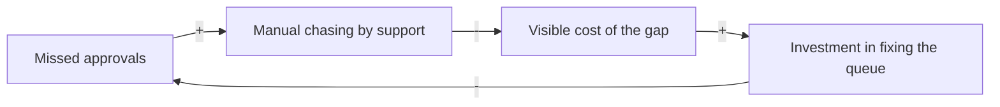

# The systems lens

Read this at step 1 for the actor map, at step 3 for the iceberg, and at step 4 for leverage points. The last two tools are conditional; read those sections only when their trigger fires.

A framing interview is linear by construction: one question, one answer, one branch. That is what makes it usable, and it is also why it produces frames that describe an episode without describing the arrangement that keeps producing it. Four of these tools cost a question or two and change what the frame can see. Two more are worth running only when something specific shows up. Everything else — Wardley maps, service blueprints, stock-and-flow models — costs a workshop and does not survive a text interview. Do not reach for them here.

## Actor map — always, step 1

Extraction at step 1 already asks for requester, primary user, beneficiary, decision-maker, and cost-bearer. Render it as a table, because the mismatches are only visible side by side:

| Actor | Experiences the problem | Decides | Holds the information |
| --- | --- | --- | --- |
| Payroll admin (requester) | Partly — sees the symptom | Yes | No |
| Approver | Directly | No | Yes |
| Finance | No | Yes, blocks | No |
| Support | Operationally | No | Yes |

The table is not the output. The **mismatches** are:

- **Decides but does not experience** — the requester is describing someone else's problem secondhand. Their account of the cause is an Interpretation, not an Observation, however senior they are.
- **Experiences but does not decide** — the person with the problem cannot authorise the fix. That is a constraint on the solution space and belongs in the constraint registry with an owner.
- **Holds the information but neither experiences nor decides** — usually support or ops. They are the cheapest evidence available and the most consistently skipped.
- **Nobody holds the information** — the frame is running on inference. Say so.

One extra question earns the table: *who else touches this, and which way does the information flow?*

## Iceberg — always, step 3

The causal grill at step 3 reaches the structure that produces a behaviour. It usually stops there. The iceberg adds one level below it, and that level is where the resistance to any solution lives.

```markdown
- **Event**: An approver missed the Thursday cutoff on the March cycle. (→ S01)
- **Pattern**: Fourteen misses in the last two quarters, all in cycles with a Finance dependency. (→ S02)
- **Structure**: Finance approval is requested by email and has no queue, so nothing tells the approver what is waiting. (→ S01, S04)
- **Mental model**: The approval was designed as a control, and speed was assumed to be the approver's problem to manage.
```

Two questions get you there, asked only after the pattern level is established:

1. *If this is a pattern rather than a one-off, what structure or policy is producing it?*
2. *What did someone believe, when that was set up, that made it look reasonable?*

The mental-model answer goes into `## Major risks`, because it predicts which solutions get blocked. A frame whose fix contradicts a belief still held by the people who own the constraint is not a design problem; it is a negotiation, and knowing that before `shaping` starts is worth more than the two questions cost.

Do not write a mental-model line that nobody expressed. "They believe users are lazy" invented by the agent is an accusation dressed as analysis. If nobody stated the belief and it cannot be inferred from a recorded decision, leave the level empty and say the structure's origin is unknown.

## Leverage points — always, agent-internal, step 4

When comparing candidate frames at step 4, judge each one on where it intervenes, using Meadows's ordering. Low leverage first:

| Level | Intervention | Durability |
| --- | --- | --- |
| 12–10 | Parameters, buffers, stock and flow structure | Cheapest, wears off |
| 9–7 | Delays, feedback loop strength | Real but slow |
| 6 | Who can see what, and when | Often the highest-value one available to a product team |
| 5 | Rules — incentives, permissions, constraints | Durable, needs authority |
| 4–3 | Who can change the structure; the system's goal | Rarely a design decision |
| 2–1 | The paradigm | Not this cycle |

**This is an analytical tool, not an interview question.** Never show the user the list, never ask them to place a frame on it, and never use the word "leverage point" in the artifact. Surface only the implication, in the frame's own vocabulary:

> Frame A changes who can see what is waiting on them, so the pattern stops recurring. Frame B adds a reminder, which works while someone maintains it and stops when they don't.

Level 6 — information flow — is worth naming as a habit. It is where most enterprise product problems that look like process problems actually sit, and it is almost always available to a product team when levels 5 and above are not.

## Object map — conditional

**Trigger**: the problem concerns a system of record, data shared across roles, or the relationship between domain entities. Skip it for flow, comprehension, or communication problems — an empty object table for a problem with no objects in dispute is worse than none, because it implies the model was checked.

| Object | Key attributes | Relationships |
| --- | --- | --- |
| Approval request | amount, status, due date, approver | belongs to a Pay cycle; assigned to an Approver; blocks a Payment |
| Pay cycle | period, cutoff, state | has many Approval requests |
| Approver | role, scope, delegate | acts on Approval requests; may delegate |

The point is classification. Every request is one of four things, and they have very different scopes:

- a **new object** — the largest, usually a different project;
- a **new attribute** on an existing object;
- a **new relationship** between existing objects — where permission and audit questions hide;
- a **new action** on an existing object.

Naming which one narrows the solution space before any solution exists, which is the only reason it is here.

## Causal loop — conditional

**Trigger**: the baseline story contains a fix that was tried and did not hold. Nothing else. "We keep solving this" is the signal; a general interest in dynamics is not.

One loop, in mermaid, with `+` for same-direction and `-` for opposite-direction links:



Read it back in one sentence — *support absorbing the cost is what keeps the gap from ever being worth fixing* — and stop. If the loop needs a paragraph to explain, it is not the finding; drop it and keep the sentence you were trying to write.

Cap it at one loop and five nodes. A second loop is a workshop, and this is an interview.

## What goes in the artifact

`## System context` holds whichever of these ran: the actor map always, the iceberg always, the object map and the causal loop only when triggered. The leverage-point judgement never appears as itself — only as the durability sentence in the frame comparison.

Omit a subsection rather than filling it thinly. An empty table in a document this size reads as an answer.
