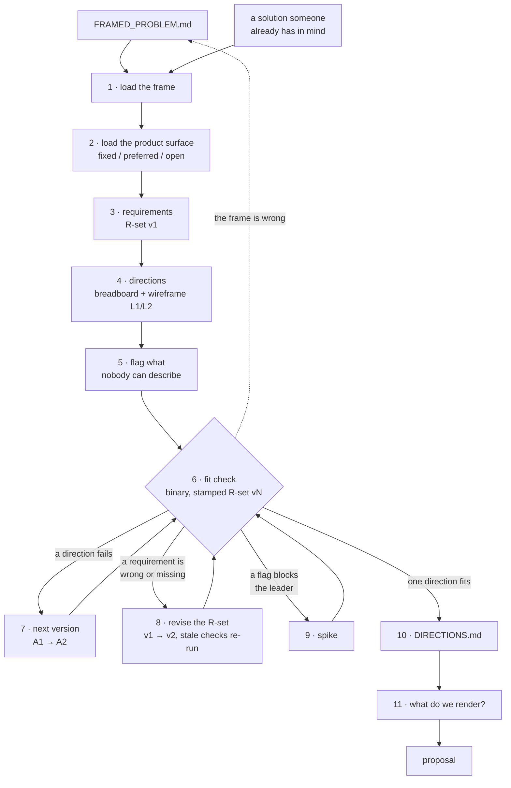

# Shaping

Take a framed problem and work out **which solution direction to go with**. Concrete enough to commit to, loose enough to leave real decisions to the people who build it.

This is not solution design. The goal is not the best possible solution; it is confidence that **a** workable one exists inside the time budget, with no unresolved unknowns hiding in it.

Work out loud. Ask one question at a time. Show the full tables every time they change — never summarise a table you have already shown, and mark changed rows with 🟡 so the user can see what moved.

Conduct the conversation and the written document in the user's language.

## How it runs

Everything between 4 and 9 is a loop, and the arrows back are the normal case, not the failure case.

## Preserve the boundary

**Input**: `FRAMED_PROBLEM.md`. Read it; never re-derive it. If the problem, user, outcome, or evidence turns out to be wrong, that is a finding to send back to `problem-framing` — not something to fix here.

Read the project context library named in the frame's `## Context use` section before asking the user for any fact about the product. Requirements are constrained by what the product already does, what components exist, and what has already been decided, and most of that is written down. Where no library is named, look once in the working repository and record what you find in `DIRECTIONS.md` so `proposal` inherits it.

Carry the frame's constraint registry, when it wrote one, into the fixed-surfaces ledger at step 2. A constraint that looks wrong is a finding to send back, not something to improve here.

**Output**: `DIRECTIONS.md` — the product surface and what is fixed in it, requirements, candidate directions with a breadboard and an L1/L2 wireframe each, the fit check, and one selected direction with no unresolved flags.

Stop there. Do not write the proposal, do not raise a wireframe past L2, do not write acceptance criteria, and do not break the work into tickets or sprints. The next skill is `proposal`, which turns the selected direction into the document people sign off on.

If no `FRAMED_PROBLEM.md` exists, say so before starting. Offer two routes: run `problem-framing` first, or proceed on a stated provisional frame that gets recorded at the top of `DIRECTIONS.md` as unverified. Never silently invent the problem.

## Notation

Fixed, because the whole thing depends on being able to point at something unambiguously.

| Level | Notation | Meaning | Relationship |
| --- | --- | --- | --- |
| Requirement | `R0`, `R1`, `R2`… | What the solution must be true of | Members of one set, `R` |
| Direction | `A`, `B`, `C`… | A whole candidate solution | Pick exactly one |
| Version | `A1`, `A2`, `A3`… | The same direction, improved | Left to right; the last live one is current |
| Part | `C1`, `C2`… | A piece of a direction | Combine within one direction |
| Alternative | `C3-A`, `C3-B`… | Two ways to do the same part | Pick one per part |

**A new letter means a different mechanism. A new number means the same mechanism, improved.** Working out the details of `B` does not make it `C`; it makes it `B2`. Getting this wrong invents choices that do not exist and makes the fit check meaningless.

## Choose the entry point

Either end works, and most real work starts at the second:

- **From `R`** — the frame is clear and no solution is on the table. Populate requirements, then sketch directions against them.
- **From a solution** — someone already has one in mind, in a deck, or half-built. Capture it as direction `A1` without judging it, then work backwards: what would have to be true for this to be the right answer? Those are the requirements. Now other directions can be compared against the same list.

Starting from a solution is not a failure. Refusing to extract the requirements from it is.

## Run the loop

The actions below are a repertoire, not a sequence. Pick the one that reduces the most uncertainty right now, do it, show the result, and pick again. Say which one you are doing and why.

### 1. Load the frame

Read `FRAMED_PROBLEM.md` and carry forward, unchanged: the problem, the desired outcome, the primary user, the boundaries and exclusions, any `Less about / More about` guardrail, the major risks, and the time budget. Carry the open assumptions too — an assumption the frame left open is a candidate requirement or a candidate spike.

Completion criterion: the frame is loaded and quoted, not paraphrased into something new, and the time budget is either stated or explicitly recorded as undefined.

### 2. Load the product surface

A direction is a proposal about a product that already exists. Find out where it lives, then record what is not up for change.

Read `references/ui-context.md` before this step. It holds the seven intake topics — host and shell, arrival, viewport targets, navigation model, design system, third-party surfaces, existing screens — the library-first ordering, and the three-tier fixed-surfaces ledger (`Fixed` / `Preferred` / `Open`).

Two rules from that file decide what happens later:

- **A `Fixed` surface becomes a constraint requirement at step 3, and a direction that changes it is an automatic `❌`.** Same mechanic as a `⚠️` part: you cannot claim a requirement is met by something the team is not allowed to do.
- **`Open` is the default.** A surface is `Fixed` or `Preferred` only when someone said so and the ledger records who. Assuming the existing interface is off-limits removes the directions worth having before anyone sees them.

Unknown is a legal answer to any of the seven. Record it as unknown; do not guess.

Completion criterion: each of the seven topics is recorded or explicitly marked unknown, every screenshot and file used is cited by path or URL, and no surface is marked `Fixed` without an owner and a reason.

### 3. Populate the requirements

Write what must be true of any acceptable solution. A requirement is a capability or a constraint, never a mechanism: *"an approver can see what is waiting on them without opening each record"*, not *"add a dashboard widget"*.

Give each one a status:

`Core goal` · `Must-have` · `Nice-to-have` · `Leaning yes` · `Leaning no` · `Undecided` · `Out`

Statuses are the scope dial. When a direction does not fit the time budget, the move is to change statuses — not to extend the time.

Never exceed nine top-level requirements. Beyond that, group them: `R3` with `R3.1`, `R3.2`. Twenty flat requirements cannot be reasoned about and always hide duplicates.

Seed the list from the frame, then write one constraint requirement per `Fixed` surface from step 2, then check the enterprise classes below explicitly. A framed problem rarely mentions any of them, and they are the requirements that kill a direction late.

A constraint requirement names the surface and its tier so the reason travels with it:

`R6  The direction does not modify the Visier navigation rail. (Fixed — vendor-owned)`

Stamp the table `R-set v1`. The set has versions, like a direction does — see step 8.

Completion criterion: every requirement is a capability or constraint with a status, no more than nine at the top level, every `Fixed` surface has a constraint requirement, each enterprise class has been either written as a requirement or marked not applicable with a reason, and the table carries an R-set version.

### 4. Sketch the directions

Produce at least two materially different directions, three when the time budget is large. Materially different means a different mechanism, not a different arrangement of the same one.

Break each into **parts a person could experience**. A part is a vertical mechanism — something that does a thing for someone. `Data model`, `API layer`, `Settings page` are horizontal layers, and a direction split into layers cannot be cut, staged, or reasoned about. Put the data with the feature that needs it.

Then make each direction concrete twice, in this order:

**First, a breadboard** — places, affordances, and connection lines, in text. That is the `breadboarding` skill; call it rather than describing the mechanism in prose. A breadboard is fast, forces you to name every affordance, and is the reason a `⚠️` becomes visible here instead of at the fit check.

**Then a wireframe**, for every direction. The breadboard's affordances *are* the wireframe's page contents — never invent a second inventory. That is the `wireframes` skill for the discipline and `tldraw-skill` for the drawing. In enterprise work the direction is frequently the layout — which shell, which entry point, which density — and a comparison nobody can see is a comparison nobody can argue with.

**Fidelity is capped at L1 or L2.** Grey bars for copy, outlined rectangles for controls, crossed boxes for media, structural labels only. No real copy, no component names, no data values, no visual polish. When someone asks for more detail, add annotation, states, or rules — never fidelity. The cap is what keeps the feedback on the mechanism, which is the reason this skill resisted wireframes at all.

Two things keep the cost of drawing every direction down:

- **Draw today first.** The current product, and any vendor UI as the vendor ships it, become row 0 of the board. Every direction inherits that chrome unchanged unless the direction is *about* the chrome, so each drawing is the evidence row plus one deliberate change.
- **A discarded direction gets one frame**, with the verdict in the title. Working drawings stop the moment a direction loses.

Read `references/ui-context.md` for the fidelity-from-evidence rule and `references/directions-board.md` for the board layout — row bands, the evidence row, frame naming, annotation gutters, the rationale column — before anything is drawn. A renderer left to its own palette will invent one, and the mark that means "decided" stops meaning it.

Completion criterion: at least two directions differ in mechanism, every part is something a person could experience, and each direction has both a breadboard and a wireframe at L1 or L2 — with the discarded ones at one frame carrying their verdict.

### 5. Flag what you do not know

Mark any part `⚠️` when the team can describe **what** it does but not **how** it works. That is a rabbit hole: not a risk, an absence.

A flagged part is an automatic `❌` in the fit check. You cannot claim a requirement is met by something nobody has worked out. This rule is what stops shaping from producing confident nonsense, so do not soften it.

Completion criterion: every part is either understood well enough to build or carries a `⚠️`.

### 6. Run the fit check

Requirements as rows, directions as columns, `✅` or `❌` in every cell. Nothing else — no partials, no "mostly", no `⚠️` in the matrix. Read `references/fit-check.md` before building the first one; it holds the exact format and how to write the failure notes.

The matrix always runs against the **current version** of each live direction. Superseded versions are history, not columns.

Two automatic `❌`, and neither is negotiable: a part carrying a `⚠️`, and a direction that changes a surface the ledger marks `Fixed`. Both are the same rule — a requirement cannot be met by something nobody has worked out, or by something the team is not allowed to do.

**Stamp the matrix with the R-set version it ran against.** A fit check is a result about one set of requirements; when the set changes at step 8, this matrix becomes history and gets re-run rather than edited.

If a direction passes everything and still feels wrong, a requirement is missing. That feeling is information: write the implicit constraint as a new `R`, then run the check again. Do not overrule the matrix.

Completion criterion: every cell is filled, every `❌` has a one-line note saying what fails, the matrix carries its R-set version, and no result contradicts someone's judgement without a new requirement to explain it.

### 7. Improve a direction into its next version

A fit check that fails is not a verdict, it is a brief. When a direction fails a requirement you care about, try to fix it: that produces a new version, not a new direction.

Read `references/version-lineage.md` before the first version bump. The rules that matter:

- A version records **what changed and why**, next to the version it replaced. `A1 → A2 → A3` reads left to right.
- A superseded version stays visible, struck through, with the reason. Never delete or overwrite one — six weeks later "we decided not to" and "we forgot" look identical.
- Only the current version of each live direction appears in the fit check.
- Discarding a whole direction is the same move at the letter level: strike it, say why, and say what would revive it.

Iterating is normal and cheap. Three versions of `A` that each fix a named failure is a better record than one version that quietly absorbed all three.

On a canvas the same rule is a timeline: close the finished iteration with a vertical rule, run the next one to its right, and keep the decisions inside the band they were taken in. `references/directions-board.md` has the layout.

Completion criterion: every version has a reason and a diff from the version before it, and no version was silently overwritten.

### 8. Revise the requirement set

The requirements are a working hypothesis, not a contract. Sketching directions and drawing them is what tests them, so expect the set to be wrong in three specific ways — and treat finding out as the work succeeding, not failing.

- **A requirement is missing.** A direction passes everything and still feels wrong. Add the implicit constraint.
- **A requirement is a direction in disguise.** Only one candidate can ever satisfy it. Retire it and write the capability it was standing in for.
- **A requirement is wrong.** The wireframe, the breadboard, or a spike showed the constraint does not hold, or holds differently. Change it.

Read `references/version-lineage.md` before the first R-set bump; the requirement rules sit alongside the direction rules there. What matters:

- The set carries a version — `R-set v1 → v2 → v3` — and each bump records every `Added`, `Changed`, or `Retired` row with its reason and **its trigger**: the direction, version, wireframe, or spike that exposed it.
- A retired requirement stays in the table, struck through, with the reason. Same rule as a discarded direction, and for the same reason.
- **Bumping the set invalidates every fit check stamped with the old one.** Mark those matrices stale, keep them, and re-run the live columns against the new set. A matrix quietly edited to match a changed requirement is the failure this stamp exists to catch.

A requirement discovered by drawing a direction is a good outcome and should read like one. Write what exposed it, so the record shows the reasoning rather than just the conclusion.

Completion criterion: every change to the set carries a reason and a trigger, no requirement was silently edited or deleted, and every live fit check runs against the current R-set.

### 9. Spike the unknowns worth resolving

A `⚠️` on a direction nobody will pick costs nothing. A `⚠️` on the leading direction has to be resolved before it can be selected.

Write a spike as its own file. Read `references/spikes.md` for the format. The rule that matters: a spike's acceptance criteria are phrased *"we can describe how…"*, never *"we can decide if…"*. Spikes buy understanding; the decision comes afterwards, back in the fit check.

Completion criterion: every `⚠️` on a contending direction has a spike or an explicit decision to carry it as a known risk.

### 10. Decide and write it up

Select one direction, at a named version. State the decisive requirement — the one that separated it from the runner-up — and what would make you reverse the decision.

Write `DIRECTIONS.md` using the structure in `templates/directions-doc.md`. Read that file before writing; it also says where to save the document.

Completion criterion: one direction at one version is selected, it carries no unresolved `⚠️`, it changes no `Fixed` surface, and the discarded directions, superseded versions, and retired requirements are kept with their reasons and what would revive them.

### 11. Choose what to render

Ask once, after the document is written: **where do we want this rendered?**

Sketching happens during the loop — a direction nobody can see is a direction nobody can argue with. This step is a different question: what becomes the shareable artifact, for the people who were not in the room.

Offer, and say which you would pick and why:

- **The directions board** — row bands, the evidence row, the fit check. For a decision meeting.
- **The wireframe set**, one row per direction, annotated. For a design review.
- **The breadboards**, drawn. For a mechanism conversation with engineering.
- **All three on one board** — evidence row, direction rows, rationale column, fit check at the foot. The default recommendation when the audience is a meeting rather than a reader, because it answers "what exists", "what are the options", and "why this one" in one pass.
- **Nothing.** `DIRECTIONS.md` is already an artifact. A document read by one person does not need a canvas.

`tldraw-skill` draws it, through `wireframes` for screens. It needs the tldraw offline desktop app running on the same machine; if it is not, say so rather than drawing somewhere else. Read `references/directions-board.md` for the layout before rendering.

Declining is a valid answer and does not block `proposal`.

Completion criterion: the question was asked, the answer is recorded in `DIRECTIONS.md` under `## Artifacts` — including "not rendered" — and anything drawn is linked from there.

## Time budget and variable scope

The time budget from the frame is a **constraint on the solution**, not an estimate of it. When a direction does not fit, the solution changes — never the budget.

Cutting is the skill. In order of preference: move a requirement to `Nice-to-have` or `Out`; replace a part with a cheaper alternative (`C3-B`); reduce a part to its first useful version; drop a part entirely. Every cut becomes a new version of the direction, with what it costs recorded.

If the frame left the time budget undefined, say plainly that no direction can be evaluated as a bounded commitment, and get a number before selecting.

## Enterprise constraints to surface

Walk these explicitly at step 2. They are the requirements a small-team method omits and an enterprise product cannot:

- **Roles and permissions** — who sees this, who acts on it, and what the same screen looks like to someone with fewer rights.
- **Workflow ownership** — whether the person who hits the problem is allowed to resolve it, or must hand it to someone else.
- **Compliance and auditability** — what must be recorded, retained, provable after the fact, or is fixed by regulation and cannot be redesigned.
- **Integrations** — what system of record this depends on, and what happens on the day it is unavailable or stale.
- **Data volume** — the direction that works for twelve rows and dies at forty thousand.
- **Operational complexity** — who supports this, and what they do when it goes wrong for one customer.
- **Accessibility** — keyboard path, focus management, screen-reader semantics, error recovery, and colour independence, written as requirements now. Accessibility discovered during Design is a scope change; accessibility written as an `R` is a constraint the direction has to satisfy.

## Readiness rule

Mark `direction-selected` only when all are true:

- `FRAMED_PROBLEM.md` was read and its problem, outcome, and boundaries are carried unchanged;
- the product surface is recorded, with unknowns named as unknowns;
- every `Fixed` surface has an owner, a reason, and a constraint requirement;
- requirements are capabilities or constraints, each with a status, nine or fewer at the top level;
- each enterprise class has been considered;
- at least two materially different directions were compared;
- every direction has a breadboard and a wireframe at L1 or L2;
- every version has a reason and every discard has one;
- every change to the requirement set has a reason and a trigger;
- the fit check is complete, binary, run against current versions and the current R-set;
- the selected version carries no unresolved `⚠️` and changes no `Fixed` surface;
- it fits the stated time budget, with every cut recorded;
- the decisive requirement and the reversal condition are written down;
- the render question was asked and its answer recorded;
- `DIRECTIONS.md` is saved next to `FRAMED_PROBLEM.md`.

Otherwise choose the most informative status: `spike-needed` when a flag blocks the leading direction; `budget-undefined` when there is no time budget to evaluate against; `no-viable-direction` when every candidate fails a `Must-have` and no cut rescues it; `reframe` when this work has shown the problem itself is wrong.

## Explain and execute the next move

- **`direction-selected`**: ask what to render (step 11), then hand `DIRECTIONS.md` and `FRAMED_PROBLEM.md` to `proposal`.
- **`spike-needed`**: name the spike, its questions, and what it must let the team describe. Return here when it lands.
- **`budget-undefined`**: ask for the time budget the business is willing to spend, and say what stays undecidable without it.
- **`no-viable-direction`**: report which `Must-have` nothing satisfies. That is a real result, and it is cheaper here than in build.
- **`reframe`**: return to `problem-framing` with the specific evidence that contradicts the frame. Do not quietly redefine the problem to fit a direction you like.

## Anti-patterns

Failure modes this skill has to actively resist. Do not let a future revision reintroduce them.

- **Re-deriving the problem.** The frame was decided already. Re-opening it here turns this into a second
  framing session that produces no direction at all. Send contradicting evidence back instead.
- **Asking the user what the product already does.** Component inventory, existing IA, current states, and
  prior proposals are in the project context library the frame names. Look before asking. A requirement
  written without knowing what exists is usually a solution in disguise.
- **Tautological requirements.** `R: users can bulk edit` next to a direction whose mechanism is bulk edit
  proves nothing. A requirement names the capability needed; a direction names the mechanism. If only one
  direction can ever satisfy it, it is that direction wearing a disguise.
- **Softening the fit check.** "Partially", "mostly", "with caveats", a `⚠️` smuggled into a cell. Binary
  is the whole point; a half-passing direction is one nobody has thought through.
- **Treating a flag as a risk.** `⚠️` does not mean "risky", it means "we cannot describe how". Risks can
  be accepted. Absences have to be resolved.
- **Splitting into horizontal layers.** "Data model", "backend work", "the UI" are not parts. They cannot
  be cut, cannot be staged, and hide the fact that nobody has decided what the thing does.
- **Promoting a version to a new letter.** `A` with its details worked out is `A2`, not `B`. A new letter
  invents a choice that does not exist.
- **Overwriting a version.** Editing `A2` in place loses the reason `A1` failed, which is the only record
  of why the current version looks the way it does. Add `A3`; strike `A2`.
- **Deleting a discarded direction.** A direction removed without a reason gets re-proposed by someone
  else three weeks later, and nobody remembers why it lost.
- **Extending time instead of cutting scope.** A direction that "just needs another week" is one that
  failed and has not been told.
- **Wireframing before breadboarding.** The wireframe's page contents come from the breadboard's
  affordances. Drawing first invents a second inventory, and the two then disagree about what the
  direction actually does.
- **Letting a shaping wireframe drift past L2.** Real copy, component names, data values, or visual
  polish move the feedback onto spacing and wording — the decisions this step exists to leave open.
  When someone asks for more detail, add annotation, states, or rules instead.
- **Redrawing the chrome in every direction.** A direction that only changes the entry point does not
  get to quietly restyle the navigation too. Every difference from row 0 must be a deliberate one, or
  the reader cannot tell what is being proposed.
- **Proposing a change to a surface the team does not own.** A vendor's UI, another team's shell, a
  regulated screen. It is not a bold direction, it is a request to a group that is not in the room.
- **Treating the whole interface as fixed because nobody said it was open.** The mirror failure, and
  the more expensive one: it removes the directions worth having before anyone sees them. `Open` is
  the default; `Fixed` needs an owner and a reason.
- **A `Fixed` surface with no owner.** An unowned constraint cannot be challenged, and one that cannot
  be challenged is indistinguishable from a habit somebody once had.
- **Editing a requirement in place.** Changing `R4` to match a direction you like, or deleting a
  requirement that turned out inconvenient, destroys the only record of what the solution was being
  judged against. Retire it, struck through, with the reason and the trigger.
- **Leaving a stale fit check standing.** A matrix stamped `R-set v1` sitting under a `v2` requirement
  table reads as a current result and is not one. Re-run it or mark it stale.
- **Designing instead of shaping.** Layouts, component names, copy, states, and edge-case behaviour are
  Design's decisions. Specifying them here removes the judgement the builders need and produces something
  too rigid to survive its first contact with reality.
- **Summarising tables.** Showing three of eleven requirements, or "the rest unchanged", breaks the user's
  ability to check the reasoning. Print the whole table, every time, with 🟡 on what moved.
- **Letting the renderer pick the encoding.** A canvas skill's generic palette reads violet as "insight or
  opportunity", so a supporting note lands in the colour this method reserves for the decision, and the
  board stops saying which one was made. Hand over the encoding in `references/directions-board.md`.
- **Violet on anything that is not the decision.** The observed case is annotation markers: numbered
  violet circles beside every screen, on a board whose selection is also violet. The reader can no
  longer find the decision by looking. Markers are grey; violet is the `★` and nothing else.
- **Redrawing the board each iteration.** A board that only shows its current state loses every reason it
  got there. Close the finished iteration with a rule, run the next to its right, keep the old bands dimmed.
- **Starring a winner per requirement.** On a fit check the best cell in each row assembles a direction
  nobody has costed or can build. Per-row selection belongs to parts and their alternatives; the fit check
  selects once, at the column level, on a whole direction.
- **Skipping the enterprise classes because the frame did not mention them.** Permissions, audit, and data
  volume are exactly the requirements that arrive late and invalidate a direction after everyone agreed.

## Reference files

- `references/ui-context.md` — the seven product-surface intake topics, the fidelity-from-evidence rule, and the three-tier fixed-surfaces ledger. Read at step 2, before sketching or drawing anything.
- `references/fit-check.md` — the matrix format, the binary rule, and how to write failure notes. Read at step 6.
- `references/version-lineage.md` — how direction versions and requirement-set versions are recorded, superseded, and discarded. Read at step 7, before the first version bump, and again at step 8.
- `references/directions-board.md` — the canvas encoding and the board layout: note colours, the selection column, iterations as a left-to-right timeline, row bands, the evidence row, frame naming, annotation gutters, and the rationale column. Read at step 4, before anything here is drawn, and again at step 11.
- `references/spikes.md` — the spike file format and the acceptance-criteria convention. Read at step 9, only when a flag blocks a contending direction.
- `templates/directions-doc.md` — the required `DIRECTIONS.md` structure and where to save it. Read at step 10.

## Method sources

- Ryan Singer, [`rjs/shaping-skills`](https://github.com/rjs/shaping-skills) — the `R`/`S` notation hierarchy, requirement statuses, the binary fit check, the flagged-unknown discipline, spikes with description-based acceptance criteria, parts as vertical mechanisms, and detailing as expansion rather than alternative.
- Ryan Singer, [*Shape Up*](https://basecamp.com/shapeup): fixed time and variable scope, the time budget as a design constraint, rabbit holes and no-gos, and working at a resolution between "design a kitchen" and "here are the blueprints".
- Ryan Singer, [some solution vs. no solution](https://www.ryansinger.co/some-solution-vs-no-solution/) and [shaping on the demand side](https://www.ryansinger.co/shaping-on-the-demand-side/): the aim is knowing a workable solution exists, not proving one is optimal, and this work legitimately runs in both directions between problem and solution.

The version lineage, the enterprise requirement classes, and the accessibility-as-requirement rule are additions, not Singer's. His method assumes a small autonomous team; enterprise B2B work does not get to.
